<!-- Perfil de andresescobar14. Animaciones SVG locales; sin scripts ni servicios externos. -->

  <picture>
    <source media="(max-width: 600px)" srcset="./assets/hero-compact-mobile.svg" />
    
  </picture>

  Soy <b>Andres Escobar</b>, desarrollador Full Stack. Transformo ideas en aplicaciones web 
  conectando interfaces, lógica de servidor y bases de datos con JavaScript y Python.

  <picture>
    <source media="(max-width: 600px)" srcset="./assets/tech-strip-mobile.svg" />
    
  </picture>

  <a href="https://github.com/andresescobar14?tab=repositories"><b>Explora mis proyectos ↗</b></a>

