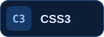

<!-- Perfil de GitHub: andresescobar14. Mantén la carpeta assets junto a este README. -->

  <picture>
    <source media="(max-width: 600px)" srcset="./assets/header-mobile.svg" />
    
  </picture>

  <b>Interfaces cuidadas. Lógica bien construida. Datos conectados.</b> 
  Desarrollo web de principio a fin con JavaScript, Python y un stack moderno.

  <a href="https://github.com/andresescobar14?tab=repositories"><b>Explora mis repositorios ↗</b></a>
  &nbsp;·&nbsp;
  <a href="https://github.com/andresescobar14?tab=stars">Lo que me inspira ↗</a>

---

## Sobre mí

Hola, soy **Andres Escobar**, **Full Stack Web Developer**. Me gusta conectar el diseño de una interfaz con la lógica que la hace funcionar: del frontend al backend y las bases de datos.

Me interesa construir aplicaciones completas, con una interfaz clara y una buena conexión entre sus componentes. Aquí encontrarás las tecnologías con las que trabajo.

## Stack tecnológico

### Frontend

  
  
  
   
  
  
  

### Backend

  
  

### Bases de datos y plataforma

  
  
  
  

## De la interfaz a los datos

| Capa | Enfoque |
| :--- | :--- |
| **Interfaz** | Componentes, estilos y experiencias web. |
| **Lógica y servidor** | Lógica de aplicación y conexión entre servicios. |
| **Datos** | Modelado, consultas y persistencia. |

  <a href="https://github.com/andresescobar14?tab=repositories"><b>Conoce mi trabajo en los repositorios ↓</b></a>

  
   
  Gracias por visitar mi perfil.

